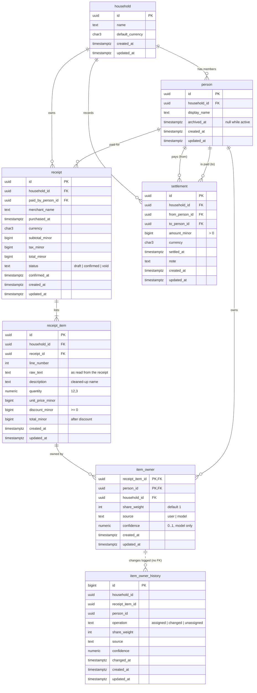

# Database schema

Divy stores its core domain in PostgreSQL 16 with the `pgvector` extension. The schema is
created and evolved only by Flyway migrations in
[`server/src/main/resources/db/migration`](../server/src/main/resources/db/migration), which the
Ktor server applies on startup before it accepts requests.

| Migration | What it does |
|---|---|
| `V1__enable_pgvector.sql` | Enables `pgvector` (used from M2; no vector columns yet). |
| `V2__core_domain.sql` | Households, people, receipts, line items, item ownership, settlements. |
| `V3__item_owner_history.sql` | Append-only log of ownership changes, kept for learning. |

## Entity-relationship diagram

## Tables

**`household`**: a group of people who shop together. `default_currency` is the currency new
receipts use unless told otherwise.

**`person`**: a member of a household. Not a login account (accounts arrive in M4 and will link
to a person). Leaving the household sets `archived_at`; the row stays so past receipts, ownership
and settlements still resolve. Active members have unique names per household (case-insensitive).

**`receipt`**: one shopping trip, paid by one person. Receipts are the source of truth. A receipt
starts as `draft`, becomes `confirmed` once its items are reviewed, and is set to `void` instead of
being deleted.

**`receipt_item`**: one line on a receipt, numbered from 1. `raw_text` is the line exactly as
read from the receipt (null for items entered by hand) and `description` is the cleaned-up name
people see. `quantity` is fractional so weighed produce fits; it is not money. `discount_minor`
is a discount on this line as a positive amount, and `total_minor` is the line total after it.
A standalone coupon line has a negative `total_minor`.

**`item_owner`**: the many-to-many link between items and people. An item can belong to:

- one person: one row;
- several people: one row each;
- everyone: one row per active member, written at assignment time. Storing each member
  explicitly means someone joining later is never retroactively charged for old items.

`share_weight` splits an item unevenly (2 and 1 means two thirds and one third); equal weights
split it evenly. `source` records whether a person or the model made the assignment, and
`confidence` holds the model's probability.

**`settlement`**: a payment from one member to another that reduces what they owe.

**`item_owner_history`**: a trigger on `item_owner` appends a row on every assignment, change
and removal. `item_owner` holds only the current answer; this log keeps the model predictions
people corrected, which is the training signal for ownership learning (M2). It has no foreign
keys so it outlives the rows it describes. Saving an unchanged assignment adds no row.

## Rules the database enforces

- **Money is integer minor units.** Every amount is a `bigint` column ending in `_minor`
  (cents for USD), stored with a `char(3)` ISO 4217 code (`receipt.currency`,
  `settlement.currency`). Items inherit their receipt's currency. No column in the schema is
  `real` or `double precision`; a test checks this.
- **Everything stays inside one household.** Child tables carry `household_id` and reference
  `person`, `receipt` and `receipt_item` through composite `(household_id, id)` foreign keys. A
  receipt's payer, an item's owners and both settlement parties must belong to the same household
  as the receipt or settlement.
- **History is not deleted by accident.** Foreign keys to `person` are `NO ACTION`, so a person
  with receipts, ownership or settlements cannot be deleted; archive them instead. These keys are
  `DEFERRABLE INITIALLY IMMEDIATE` so that `HouseholdRepository.delete` can defer them and let a
  full household deletion cascade through receipts and items first.
- **Timestamps.** Every table has `created_at` and `updated_at` (`timestamptz`, UTC);
  a `BEFORE UPDATE` trigger maintains `updated_at`.
- **Checks.** Currency codes match `^[A-Z]{3}$`; names and descriptions are not blank; line
  numbers, quantities, share weights and settlement amounts are positive; confidence is within
  [0, 1]; a person cannot settle with themselves; a confirmed receipt has `confirmed_at`.

## Indexes

Besides primary keys and the unique keys above:

| Index | Serves |
|---|---|
| `receipt (household_id, purchased_at DESC)` | A household's receipts, newest first. |
| `receipt (household_id, paid_by_person_id)` | Receipts paid by a person; payer FK. |
| `receipt_item (receipt_id, line_number)` unique | Items of a receipt in order. |
| `item_owner (household_id, person_id)` | Items a person owns; owner FK. |
| `person (household_id, lower(display_name))` unique, active only | Name uniqueness. |
| `settlement (household_id, settled_at DESC)` | A household's settlements, newest first. |
| `settlement (household_id, from_person_id)`, `(household_id, to_person_id)` | Balances per person; FKs. |
| `item_owner_history (receipt_item_id, changed_at)`, `(household_id, changed_at)` | Training data export. |

## Data access

The Ktor module reads and writes through repository interfaces in
`com.monster0506.divvy.server.repository` (`HouseholdRepository`, `PersonRepository`,
`ReceiptRepository`, `ItemOwnerRepository`, `SettlementRepository`), implemented with Exposed DSL
in `ExposedRepositories`. `configureDatabase` builds them once at startup and routes reach them
through `application.repositories`. `ReceiptRepository.create` writes a receipt, its items and
their owners in one transaction. The Exposed table objects in `com.monster0506.divvy.server.db`
only describe columns; the migrations are the source of truth, and `SchemaUtils` is never used to
create tables.

## Configuration

The server reads these environment variables on startup:

| Variable | Example |
|---|---|
| `DATABASE_URL` | `jdbc:postgresql://db:5432/divy` |
| `DATABASE_USER` | `divy` |
| `DATABASE_PASSWORD` | (secret) |
| `DATABASE_POOL_SIZE` | `10` (optional) |

`CREATE EXTENSION vector` needs a superuser, which the `pgvector/pgvector:pg16` image's
`POSTGRES_USER` is. If the application later connects as a less-privileged role, create the
extension once as a superuser first; `V1` uses `IF NOT EXISTS` and will then succeed.

## Adding a migration

Add a new file `V<next>__<description>.sql`; never edit a migration that has been merged, since
Flyway validates checksums on startup and the server will refuse to start. Run
`./gradlew :server:test` to apply every migration to a fresh PostgreSQL 16 + pgvector container.